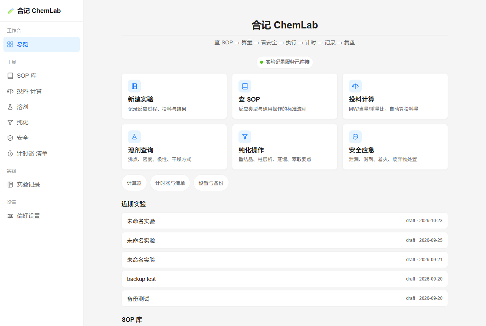
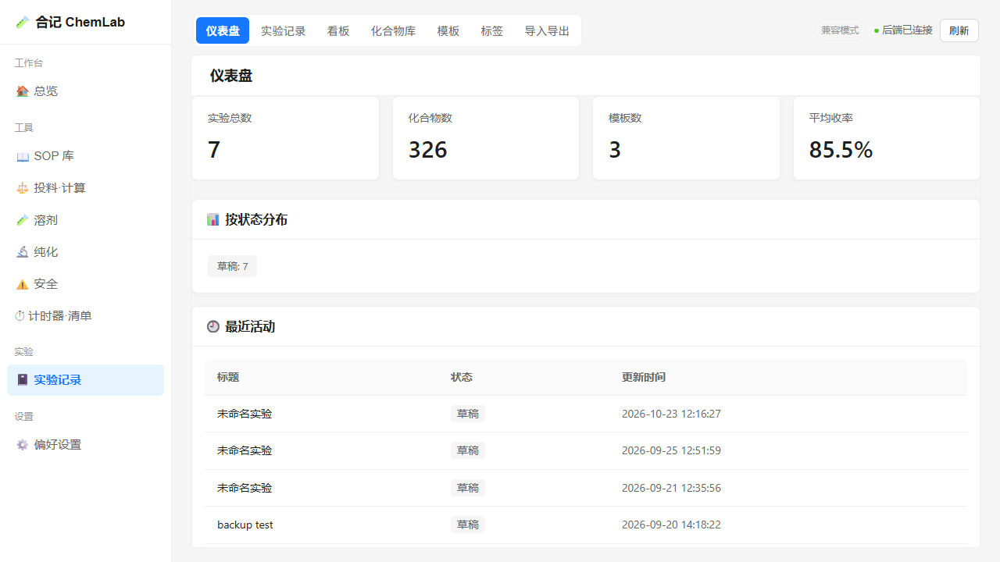
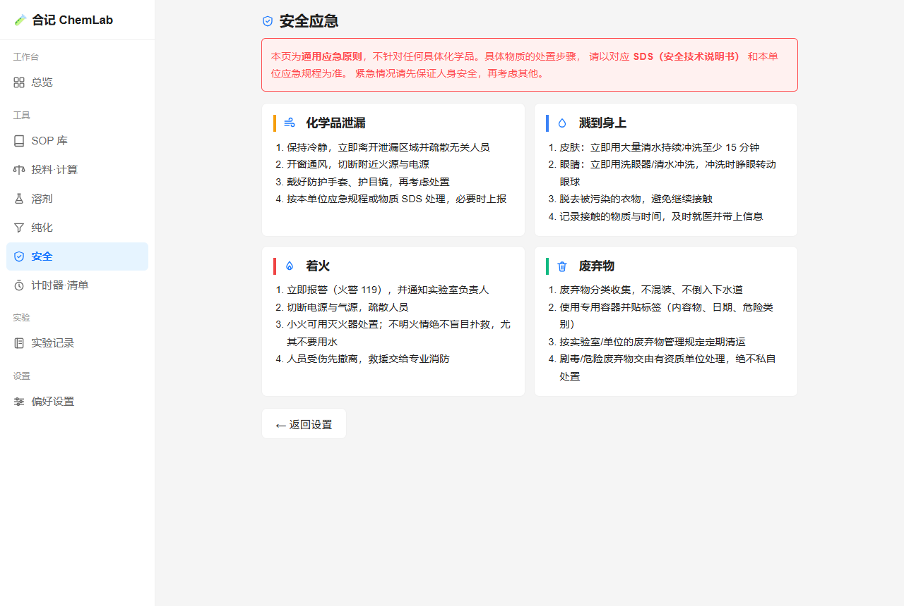

# 合记 ChemLab

> 有机合成实验室的日常工具台 —— 查 SOP → 算投料 → 看安全 → 执行 → 计时 → 记录 → 复盘，一个窗口走完。

Windows 桌面应用，单机运行，数据全部留在本机。内置 18 套标准操作流程、235 种常用溶剂数据、233 条化学品性质，以及基于 RDKit 的电子实验记录（ELN）。



---

## 这个工具解决什么问题

做合成的日常是零散的：SOP 在某个 PDF 里，投料量用计算器按，溶剂性质要翻手册，安全规程贴在墙上，实验记录写在纸质本上。每一步都在切换工具。

ChemLab 把它们收进一个窗口，并且**按实际做实验的顺序排布**：

```
查 SOP（这一步怎么做）
  ↓
算投料（多少克、多少当量、多少毫升）
  ↓
看安全（这个试剂要注意什么、泄漏怎么办）
  ↓
执行 + 计时（反应跑着，计时器盯着）
  ↓
记录（投料、现象、后处理、产率）
  ↓
复盘（同类反应以前做得怎么样）
```

## 功能

### 工具

| 模块 | 内容 |
| --- | --- |
| **SOP 库** | 18 套标准操作流程，按「反应类型 / 通用操作」分类，支持收藏、步骤勾选、风险提示 |
| **投料计算** | 由分子量、当量、浓度反算投料量，支持切换限量试剂基准 |
| **溶剂查询** | 235 种溶剂的沸点、密度、极性、干燥方式、替代品建议 |
| **纯化操作** | 重结晶、柱层析、蒸馏、萃取的操作要点与常见坑 |
| **安全应急** | 泄漏、溅到、着火、废弃物四类场景的通用处置原则 |
| **计时器 / 清单** | 多组并行计时（回流、滴加、静置）、实验步骤清单 |

### 实验记录（ELN）

由内置的 Python 后端提供，化学能力基于 RDKit：

- **实验记录**：投料、现象、后处理、产率，富文本编辑
- **化合物库**：233 条化学品性质，可按结构检索
- **结构式**：输入 SMILES 或从 ChemDraw 粘贴 Molfile，RDKit 校验后渲染成图；SMILES / InChI 互转
- **模板与标签**：常用实验类型一键套用
- **多格式导出**

### 其他

- 100% 离线，不需要联网、不需要账号
- 一键导出 JSON 状态备份
- 浅色主题，16px 基准字号，可调字体大小与「手套模式」（按钮更大，戴手套也能点）

## 截图

| 实验记录 | 安全应急 |
| --- | --- |
|  |  |

## 安装使用

下载 `合记 ChemLab_x.y.z_x64-setup.exe` 双击安装。首次启动会拉起本地后端（约 10 秒），随后自动打开浏览器界面。

> **关于「未知发布者」提示**
>
> 本项目**不做代码签名** —— 商业代码签名证书年费数千元，对一个开源工具没必要。
> 因此 Windows SmartScreen 在首次运行时会提示「未知发布者」，
> 点「更多信息」→「仍要运行」即可。这是所有未签名开源软件的常态。
>
> 如果你介意这一点，有两条路：
> 1. **自行构建** —— 用本仓库源码跑 `build/build.ps1`，这是最彻底的验证方式
> 2. 用 `sigcheck -h <文件>` 或 VirusTotal 核对发布包的哈希
>
> 另外，可执行文件首次被杀软拦截也偶有发生（PyInstaller 打包的常见现象），
> 处理办法见 [`docs/杀软误报说明.md`](docs/杀软误报说明.md)。

## 从源码运行

**环境要求**：Node.js ≥ 20、Python 3.13、Rust stable（仅打包需要）、Windows 10/11

```bash
# 1. 前端依赖
npm install

# 2. Python 后端
cd backend
python -m venv venv
venv/Scripts/pip install -r requirements.txt

# 3. 启动后端（开发时单独跑）
venv/Scripts/python main.py --port 8765

# 4. 另开终端，启动前端
npm run dev          # 只跑网页，浏览器访问，最轻
npm run tauri dev    # 带壳的桌面版
```

打包安装包：

```bash
powershell -ExecutionPolicy Bypass -File build/build.ps1 -Fast
# 产物在 src-tauri/target/release/bundle/nsis/
```

> **关于包管理器**：本项目用 npm 而非 pnpm。pnpm 在 Windows 上创建
> `node_modules` 顶层符号链接需要开发者模式，没权限时会静默失败
> —— `.pnpm` 里包是完整的，但 `vue-tsc` 这些入口不生成，报
> `Cannot find module`。npm 的扁平结构没有这个问题。

## 技术栈

| 层 | 技术 | 说明 |
| --- | --- | --- |
| 桌面壳 | Tauri 2.11 + Rust | 只做三件事：拉起 Python 后端、启动器模式开浏览器、管理子 webview |
| 前端 | Vue 3 + TypeScript + Vite | 12 个页面，hash 路由，无 UI 框架依赖 |
| 后端 | FastAPI + SQLite | 实验记录 / 化合物 / 模板 / 检索 |
| 化学引擎 | RDKit | SMILES 解析、子结构检索、InChIKey、性质计算 |
| 打包 | PyInstaller onedir + NSIS | Python 环境打进 sidecar，用户无需装 Python |

**为什么是「Rust 壳 + Python 子进程」而不是全 Rust**：RDKit 没有成熟的 Rust 等价物（SMILES 解析、子结构检索、2D 结构渲染），强行重写等于功能缩水。壳只负责进程生命周期，业务逻辑留在 Python。

## 目录结构

```
ChemLab/
├── src/                    Vue 前端（12 个页面）
│   ├── views/              工作台 / SOP / 投料 / 溶剂 / 纯化 / 安全 / 计时器 / 实验记录 / 设置
│   ├── components/         AppIcon（内联 SVG 图标）、TimerList、ChecklistPanel 等
│   └── data/solvents.ts    235 种溶剂数据
├── src-tauri/              Rust 桌面壳
│   ├── src/commands.rs     后端状态 / 重启 / 启动自检
│   ├── src/backend.rs      Python 后端子进程生命周期
│   └── src/lab.rs          实验记录子 webview（原生，非 iframe）
├── backend/                Python 后端（FastAPI + RDKit）
│   ├── main.py             入口
│   ├── routers/            实验 / 化合物 / 模板 / 检索 / 数据
│   └── database.py         SQLite schema 与迁移
├── frontend-chemeln/       ELN 静态前端（原生 JS，无构建步骤）
├── assets/sops/            18 套 SOP（Markdown）
├── shared/chemistry-data.json   化学数据单一真源（233 条）
├── DESIGN.md               视觉规范（改 UI 前先读）
├── build/                  打包、验收脚本
└── docs/                   设计文档、UI 审计报告
```

## 数据来源与授权

内置数据整理自公开的互联网资料（试剂厂商公开的 SDS、公开化学数据库、
公开发布的操作规范），不来自任何受限制的内部资料或商业出版物。

| 内容 | 数量 | 来源 |
| --- | --- | --- |
| `assets/sops/` | 18 套 SOP | 按公开的通用操作规范整理编写 |
| `src/data/solvents.ts` | 235 种溶剂 | 物性数据整理自公开来源 |
| `shared/chemistry-data.json` | 233 条化学品 | 化学品基础信息（CAS、分子式、分子量等） |

这些内容的主体是**事实性信息** —— CAS 号、沸点、密度、溶解度、分子量等。
著作权保护的是「独创性表达」而非事实本身，所以这类数据的采集与再整理不构成侵权。
SOP 文本为按公开规范自行编写，非抄录特定出版物。

数据与代码采用同一许可证（MIT）。**但请注意**：化学数据随来源更新、测量条件不同
会有出入，请以试剂 SDS 和权威数据库为准，本项目不保证其准确性与完整性。

## 许可证

代码与内置数据均采用 [MIT License](LICENSE)。

## 免责声明

本项目是实验**辅助工具**，提供通用操作参考，**不能替代**：

- 具体化学品的安全数据表（SDS）
- 本单位的操作规程与安全管理制度
- 有资质人员的专业判断

涉及具体化学品处置、危险反应操作，务必以 SDS 和本单位规程为准。因使用本项目造成的任何后果，作者不承担责任。
