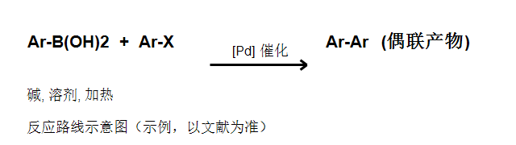

## 风险

> 本页为**模板填写示例**（Suzuki 偶联为 2010 年诺奖公开反应，参数为教科书通用值）。
> 实际实验前必须：① 查所用每种试剂的 SDS；② 做风险评估；③ 按单位规程操作。
> 钯催化剂有毒/致敏，避免吸入粉尘；有机溶剂易燃，远离明火并通风。

## 反应路线

<!-- 插图写法示范：
     图片放在与 .md 相同的目录（或子目录，如 图片/xxx.png）
     由 ChemDraw/KingDraw 等画出后导出 PNG 即可
     建议：图片文件名用英文（中文名会经过 URL 编码，多一道坑） -->

## 试剂

| 试剂 | 用量 | 分子量 | 备注 |
| --- | --- | --- | --- |
| 芳基卤化物（如 4-溴苯甲醚） | 1.0 mmol | 按实际 | 限制试剂，决定产物 |
| 芳基硼酸（如苯硼酸） | 1.2–1.5 mmol | 按实际 | 稍过量，价格通常较低 |
| 钯催化剂（Pd(PPh3)4 或 Pd(OAc)2/配体） | 1–5 mol% | 按实际 | 惰性气氛下称量 |
| 碱（K2CO3 或 K3PO4） | 2–3 equiv | 按实际 | 水相加入 |
| 溶剂（THF/水 或 甲苯/EtOH/水） | 按文献 | — | 使用前脱气 |

## 步骤

1. 无水无氧操作（Schlenk 线或手套箱），惰性气体保护下加入钯催化剂与配体
2. 依次加入芳基卤化物、芳基硼酸、碱、溶剂，充分脱气
3. 加热至回流（或指定温度）并搅拌，TLC 或 GC-MS 监控至原料消耗
4. 冷却至室温，转入后处理

## 后处理

- 加水与乙酸乙酯分液；水相再用乙酸乙酯萃取 2 次
- 合并有机相，饱和食盐水洗涤，无水硫酸钠干燥，过滤浓缩

## 纯化

- 柱层析：石油醚/乙酸乙酯梯度（示例 0 → 20%）
- 或重结晶（适用时）

## 表征

- ¹H NMR、¹³C NMR、MS（ESI 或 APCI）
- 固体产物测熔点

## 排错

| 现象 | 可能原因 | 处理 |
| --- | --- | --- |
| 转化率低/不反应 | 氧或水进入、催化剂失活 | 严格无氧、换新鲜催化剂、适当升温 |
| 脱卤或均偶联副产物多 | 碱过量、温度过高 | 调碱当量、降温、换配体优化 |
| 纯化拖尾/产物不纯 | 硅胶过载、梯度太陡 | 减小上样量、放缓梯度 |

## 参考

- Miyaura, N.; Suzuki, A. Chem. Rev. **1995**, 95, 2457–2483. DOI: 10.1021/cr00039a007
